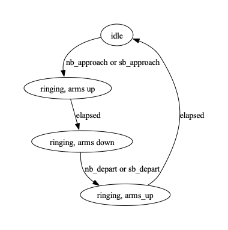
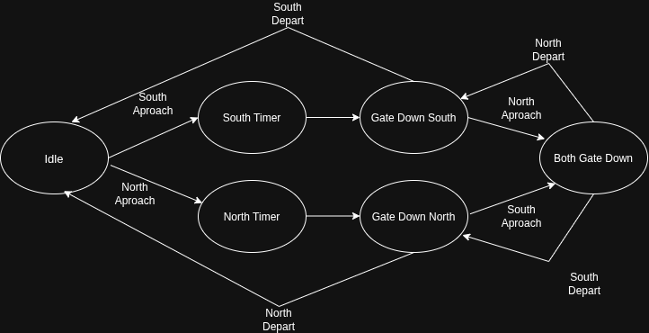
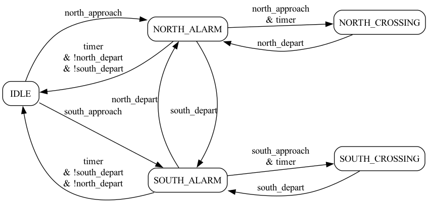
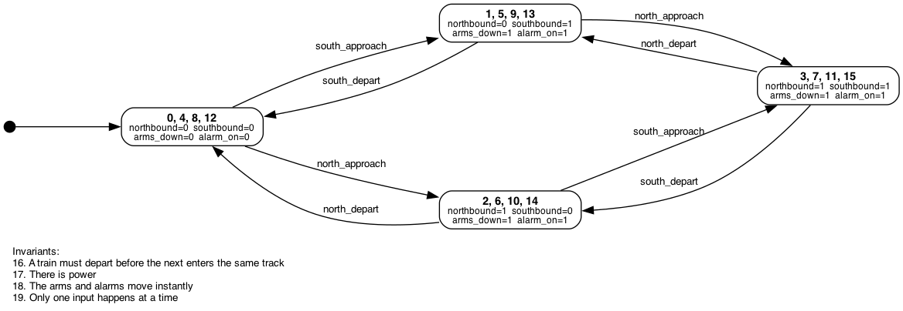

 # Lab 9

## Invariants
- There is power.
- The trains operate within a certain speed limit, such that they can't cross the distance between the sensor and the crossing before the elapsed time.
- The motor for the arms works.
- Only one input can happen at a time

## Varying invariants
 -  If there are two trains on the track, such that one train leaves triggering arms up while the other train remains on the tracks the system will be in an unsafe state.

## Check your work

### Owen's Train Crossing Diagram

### Eric's Train Crossing Diagram

## Prove It

| number | arms_down | alarm_on | northbound_present | southbound_present | north_approach | south_approach | north_depart | south_depart | Timer   | safety_hazard |
|--------|-----------|----------|--------------------|--------------------|----------------|----------------|--------------|--------------|---------|---------------|
| 0      | 0         | 0        | 0                  | 0                  |        6       |        5       |     18       |      18      |   0     |               |
| 1      | 0         | 0        | 0                  | 1                  |        16      |        16      |     18       |      0       |   16    |     16        |
| 2      | 0         | 0        | 1                  | 0                  |        16      |        16      |     0        |      16      |   16    |     16        |
| 3      | 0         | 0        | 1                  | 1                  |        16      |        16      |     16       |      16      |   16    |               |
| 4      | 0         | 1        | 0                  | 0                  |        6       |        5       |     0        |      0       |   0     |               |
| 5      | 0         | 1        | 0                  | 1                  |        7       |        17      |     18       |      0       |   13    |               |
| 6      | 0         | 1        | 1                  | 0                  |        17      |        7       |     0        |      18      |   14    |               |
| 7      | 0         | 1        | 1                  | 1                  |        17      |        17      |     5        |      6       |   15    |               |
| 8      | 1         | 0        | 0                  | 0                  |        0       |        13      |     18       |      18      |   0     |               |
| 9      | 1         | 0        | 0                  | 1                  |        15      |        17      |     18       |      0       |   13    |      16       |
| 10     | 1         | 0        | 1                  | 0                  |        17      |        15      |     0        |      18      |   14    |      16       |
| 11     | 1         | 0        | 1                  | 1                  |        17      |        17      |     13       |      14      |   15    |      16       |
| 12     | 1         | 1        | 0                  | 0                  |        14      |        13      |     18       |      18      |   0     |               |
| 13     | 1         | 1        | 0                  | 1                  |        15      |        17      |     18       |      0       |   13    |               |
| 14     | 1         | 1        | 1                  | 0                  |        17      |        15      |     0        |      18      |   14    |               |
| 15     | 1         | 1        | 1                  | 1                  |        17      |        17      |     13       |      14      |   15    |               |

| number | invariant                                                 |
|--------|-----------------------------------------------------------|
| 16     | A train is present and the arms and alarm are not down    |
| 17     | A train must depart before the next enters the same track |
| 18     | A train must exist to depart                              |

## Specification vs.implementation

## Model Checking
The created table follows our state diagrams for all of the valid states, but adds the unreachable states and shows all of the invalid inputs. We were relatively lenient on erroneous inputs that we deemed as safe, such as the timer randomly going off when it wasn't set. 

The new FMS is similar to our original graphs but does have some differences. In our original graphs, we didn't have combined states in mind, so this new graph gives us a more explicit, exhaustive idea of how the state machine would work. 

It is easy to see how a state machine can grow extremely complex with relatively few added states. It essentially grows at a rate of 2n where n is the number of states. This can make it nearly impossible to test each case with even a mildly complex system. 
